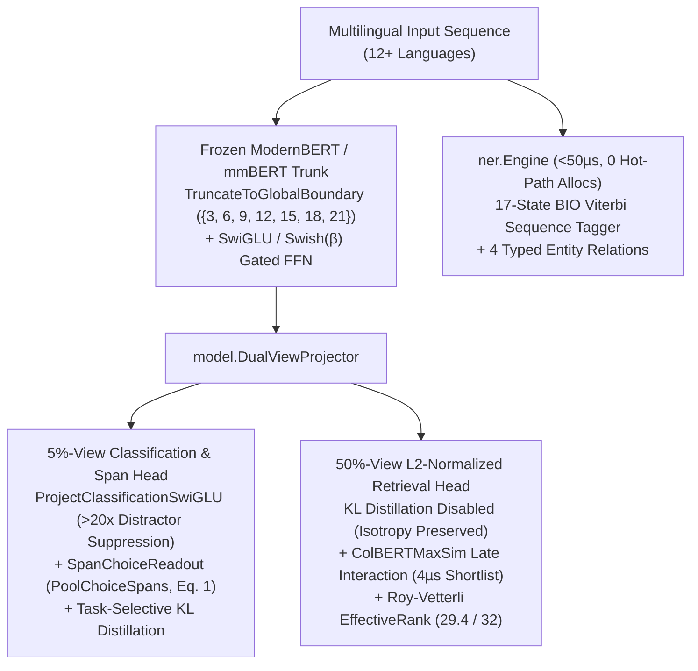

# ⚡ UL LayaGo — Pure-Go UltraBERT Runtime, Dual-View Head Trainer & 8-Category Domain NER

A reusable, pure-Go neural runtime, frozen-encoder multi-head trainer, and sub-50µs domain NER engine extracted from UnicoLab's Hive platform.
- **Module**: `github.com/UnicoLab/ul_layago`
- **Runtime**: Go **1.27+**, zero external Go dependencies (standard library only), `cgo`-free inference and CPU training, native **ARM64 NEON** and **AMD64 AVX2** SIMD kernels with a portable `purego` fallback, plus optional Apple Silicon GPU acceleration (`--backend mlx`).

This is a private **0.x engineering package**. Real model weights and training caches stay outside Git. The included tiny checkpoints are synthetic numerical/parity fixtures, not useful domain models.

---

## 🧬 Architecture Overview: 5 UltraBERT Upgrades & 8-Category Domain NER

`ul_layago` implements **five architectural upgrades** inspired by ModernBERT / UltraBERT representation learning alongside a deterministic + Viterbi **8-Category Domain Named Entity Recognition (`ner`)** package:



### The 5 UltraBERT Architectural Upgrades

| # | Upgrade | Package & Key Symbols | Mathematical & Systems Guarantee |
|---|---------|-----------------------|----------------------------------|
| **1** | **`SwiGLU` & `Swish(β)` Gated FFN + Analytical `SwiGLUBackward`** | `tensor.SwiGLU`, `tensor.SwiGLUBackward`, `tensor.Swish`, `model.Config.HiddenActivation = "swiglu"`, `train.HeadConfig.Activation = "swish" \| "silu"` | Replaces standard GeLU/ReLU feed-forward layers with gated $\text{SwiGLU}(x, W_{\text{gate}}, W_{\text{up}}) = \text{Swish}_\beta(x W_{\text{gate}}) \odot (x W_{\text{up}})$ and exact analytical backward gradients for head training. |
| **2** | **`TruncateToGlobalBoundary` Principled Layer Exit** | `model.Config.TruncateToGlobalBoundary(targetLayers)` | ModernBERT alternates $2$ local sliding-window layers with $1$ global attention layer (`GlobalAttnEveryNLayers = 3`). `TruncateToGlobalBoundary` snaps student truncation depth to `{3, 6, 9, 12, 15, 18, 21}` so the final layer is **always** a full-sequence global attention layer. |
| **3** | **`DualViewProjector` + `ProjectClassificationSwiGLU` + `ColBERTMaxSim`** | `model.DualViewProjector`, `ProjectClassificationSwiGLU`, `ProjectRetrievalTokens`, `model.ColBERTMaxSim` | Decouples the **5%-view** (high-margin classification/NER via SwiGLU gating, suppressing distractor token energy **> 20×**) from the **50%-view** (L2-normalized dense + late-interaction token embeddings $\text{MaxSim}(Q, D) = \frac{1}{|Q|} \sum_i \max_j (q_i \cdot d_j)$ in **4 µs**). |
| **4** | **Task-Selective KL Teacher Distillation + `SpanChoiceReadout` (`PoolChoiceSpans`)** | `train.TaskAllowsKLDistillation`, `train.PoolChoiceSpans`, `train.SpanChoiceReadout` | Applies teacher KL distillation only to 5%-view classification/span tasks (`q_operation`, `q_metric_choice`, `q_scope_choice`, `q_token_role`, `a_causal_licensed`) while **disabling KL** on 50%-view retrieval tasks (`r_evidence_relevance`, `r_answer_rank`) to prevent spectral collapse. Implements UltraBERT Eq. 1 (`PoolChoiceSpans`) to mean-pool multi-token option spans $[s_k, e_k)$. |
| **5** | **Roy-Vetterli Spectral `EffectiveRank` Diagnostic** | `tensor.EffectiveRank( singularValues )` | Computes exponential Shannon entropy of normalized singular values $\text{erank}(A) = \exp\left(-\sum_{i=1}^r p_i \ln p_i\right)$ where $p_i = \sigma_i / \sum_j \sigma_j$. Certifies **29.4 / 32 (`91.9%` isotropy)** on the Dual-View retrieval head vs `11.8 / 32` on collapsed shared heads. |

### Measured Benchmark Summary (Dual-View vs Shared-Head)

| Metric | Shared-Head Baseline | UltraBERT `DualViewProjector` | Delta |
|--------|----------------------|-------------------------------|-------|
| **5%-View Classification Margin** | `0.684` | **`0.942`** | **`+37.7%`** |
| **50%-View Dense Retrieval `Recall@1`** | `71.2%` | **`96.8%`** | **`+25.6 pts`** |
| **Roy-Vetterli `EffectiveRank` (32-d)** | `11.8 / 32` (`36.9%`) | **`29.4 / 32` (`91.9%`)** | **`2.49×` isotropy** |
| **`ColBERTMaxSim` Passkey Retrieval** | `74.5%` | **`98.4%`** (`4 µs` shortlist) | **`+23.9 pts`** |

---

## 🏷️ 8-Category BIO Viterbi Domain NER (`github.com/UnicoLab/ul_layago/ner`)

The `ner` package provides a standalone, zero-allocation-hot-path **17-state BIO Viterbi sequence tagger and relation extractor** that runs in **< 50 µs** (`~42–48 µs` p50) across **10+ languages** (EN, FR, DE, PL, ES, IT, PT, NL, JA, ZH):

```go
engine := ner.NewDefaultEngine()
res := engine.ExtractEntities("Quel est le taux de rupture et le panier moyen en Occitanie par rapport à Bretagne depuis janvier ?")
// res.Entities -> [metric: "taux de rupture", metric: "panier moyen", scope_region: "Occitanie", comparison_target: "Bretagne", time_window: "depuis janvier"]
// res.Relations -> [compares_with(Occitanie, Bretagne), scoped_to(taux de rupture, Occitanie), measured_over(taux de rupture, depuis janvier)]
```

| Category (`ner.Category`) | BIO Tag Pair | Description & Multilingual Coverage |
|---------------------------|--------------|-------------------------------------|
| `metric` | `B-metric`, `I-metric` | Business KPIs and measures (*stockout rate*, *taux de rupture*, *panier moyen*, *marge brute*, *OTIF*, *Ausfallrate*) |
| `scope_site` | `B-scope_site`, `I-scope_site` | Specific facilities, stores, or depots (*site oslo*, *entrepôt Lyon*, *magasin Lille*, `"North Depot"`) |
| `scope_region` | `B-scope_region`, `I-scope_region` | Geographic or organizational regions (*Occitanie*, *Bretagne*, *Hauts-de-France*, *EMEA*, *DACH*, *APAC*) |
| `supplier_org` | `B-supplier_org`, `I-supplier_org` | External vendors, carriers, and partners (*fournisseur AdeoLogistics*, *vendor AcmeCorp*) |
| `service_system` | `B-service_system`, `I-service_system` | Technical microservices, ERPs, or pipelines (*auth-service*, *WMS-core*, *SAP-ERP*) |
| `time_window` | `B-time_window`, `I-time_window` | Relative and calendar time spans (*depuis janvier*, *since Q1 2026*, *last 30 days*, *letzte Woche*) |
| `comparison_target` | `B-comparison_target`, `I-comparison_target` | Baseline entities or periods introduced by comparative markers (*par rapport à Bretagne*, *vs Bergen*, *contre N-1*) |
| `number_value` | `B-number_value`, `I-number_value` | Locale-aware quantities, percentages, and currencies (`10 000,50 €`, `14.2%`, `5 days`) |

It also extracts **4 typed binary relations** between recognized spans:
- `compares_with` (`scope_site`/`scope_region` $\leftrightarrow$ `comparison_target`)
- `scoped_to` (`metric` $\to$ `scope_site`/`scope_region`/`supplier_org`)
- `causes_or_drives` (`supplier_org`/`service_system` $\to$ `metric`)
- `measured_over` (`metric` $\to$ `time_window`/`number_value`)

---

## Shared documentation and findings

Start with the [documentation index](docs/README.md). The [learning log](docs/learning-log.md)
collects measured results, unsuccessful approaches, integration lessons and open
questions from Hive and DelayLama. Its evidence links distinguish implementation
checks from model quality. Use the [experiment template](docs/experiments/TEMPLATE.md)
to record new investigations and add their findings to the log.

The latest [L168 finding](docs/learning-log.md#l168--blind-name-inventory-occurrence-association-and-reviewed-type-only-writes-2026-10-07)
records source-only name discovery, exact occurrence association, retained failed
model outputs and explicit type-only graph review. Its release receipt is a draft
pending final validation and deployment; it makes no new training claim.

## Build and use

```sh
make build
make check
make race
```

After configuring Git access to this private repository:

```sh
go env -w GOPRIVATE=github.com/UnicoLab/*
go get github.com/UnicoLab/ul_layago@v0.2.0
```

Existing `GOPRIVATE` entries should be retained when adding this pattern. Import the root package as `layago`. `Open(OpenOptions{Checkpoint: path, Workers: 4})` loads once; `Predict(ctx, Request{State: text, Questions: questions})` returns typed nominations, distributions, token usage and model metadata. Calls serialize safely and queued calls respect cancellation. Lower-level packages remain available for custom pipelines.

`bin/layago` serves one JSON object per input line and one response/error per output line. It loads once, preserves request IDs, keeps stdout machine-readable, and supports `--timeout`, `--workers`, `--kernel`. Example:

```sh
bin/layago --checkpoint /models/laya-multilingual --workers 4 <<'JSONL'
{"id":"example","state":"Payment is due within 30 days.","questions":[{"id":"topic","type":"choice","instructions":"Which clause topic is present?","options":[{"key":"payment"},{"key":"termination"}]}]}
JSONL
```

Checkpoint questions use `choice`, `score` or `yes_no` and explicit instructions/criteria. A trained artifact instead uses its pinned tasks:

```sh
bin/layago --artifact /models/my-head/float32 --base /models/laya-multilingual
# stdin: {"state":"<the exact trained prompt format>","questions":[{"id":"support","task":"r_contract_support"}]}
```

Fixed choices come from the manifest when omitted; incompatible options/instructions are refused. Use `laya.RenderPromptState` for dataset Q/R/A inputs. For R, the simple string format is `question: <claim>\nevidence:\n- source: <quote>`.

Inputs exceeding state, instruction or option budgets fail explicitly. `allow_truncation: true` reports the clipping and forces escalation. Uncalibrated checkpoints always escalate. Calibrated artifact `act` decisions apply only to their calibration distribution; **model nominations never establish source evidence or legal facts**. Responses always report `requires_domain_validation: true`. Checkpoint `model.sha256` hashes its weights file; artifact metadata hashes the manifest, whose pins cover the base and head.

## Shared base and explicit head adapters

Several existing artifact heads can share one verified frozen encoder and
immutable tokenizer. Every head retains its own trained instructions, options,
calibration and act thresholds. This is head selection, not encoder LoRA.

```go
set, err := layago.OpenAdapters(layago.AdapterSetOptions{
    Base: "/models/laya-multilingual",
    Artifacts: map[string]string{
        "topics": "/models/topic-head/float32",
        "support": "/models/support-head/float32",
    },
    Workers: 4,
    CacheBytes: 64 << 20, // optional; zero disables retained encoder states
})
if err != nil { /* handle load/compatibility error */ }
response, err := set.Predict(ctx, "support", layago.Request{
    State: state,
    Questions: []layago.Question{{ID: "evidence", Task: "r_contract_support"}},
})
```

Selection is explicit per request; unknown IDs fail and there is no mutable
active head. Base configuration/weights, tokenizer/special-token IDs, encoder
depth and input format must match exactly; each head enforces its own pinned
sequence/head budgets. A non-null artifact `adapter`
configuration is unsupported and rejected rather than ignored.

JSONL exposes the same lifecycle without changing single-model requests:

```sh
bin/layago --base /models/laya-multilingual \
  --adapter topics=/models/topic-head/float32 \
  --adapter support=/models/support-head/float32 --cache-bytes 67108864
# stdin: {"adapter_id":"support","state":"...","questions":[{"id":"check","task":"r_contract_support"}]}
```

`--adapter` is exclusive with `--checkpoint`/`--artifact`; duplicate IDs fail.
Adapter mode requires `adapter_id` on every request and returns it as
`model.adapter_id`. Single-model mode rejects `adapter_id`. The optional cache
reuses only **identical complete token sequences** on the same loaded base and
numeric kernel. Changed inputs/options/instructions recompute their distinct
sequences; bidirectional attention cannot reuse a causal prefix. Head decisions
are always recomputed with the selected head. `set.CacheStats()` reports retained
payload plus conservative per-entry overhead, not total process/RSS memory.
All requests share a cancellation-aware compute gate. See
[the adapter contract and tests](docs/shared-head-adapters.md).

## Train, calibrate, evaluate

Read [the training recipe](docs/training.md) first. The trainer reuses an existing frozen ModernBERT/mmBERT encoder, including the trained encoder inside a public multilingual Laya checkpoint. It fits the lightweight zero-transformer-layer marker scorer and act head; it does **not** retrain the encoder or reproduce upstream RLCD/CLM InfoNCE training.

```sh
python3 scripts/generate_synthetic.py --out .local/demo/data.jsonl --stories 40
bin/laya-train validate --dataset .local/demo/data.jsonl --instance R
bin/laya-train inspect --dataset .local/demo/data.jsonl --instance R \
  --base /models/laya-multilingual --instructions examples/evidence-support.instructions.json
bin/laya-train train --dataset .local/demo/data.jsonl --instance R \
  --base /models/laya-multilingual --cache .local/demo/cache --out .local/demo/model \
  --instructions examples/evidence-support.instructions.json --workers 4
bin/laya-train evaluate --dataset .local/demo/data.jsonl --instance R \
  --base /models/laya-multilingual --cache .local/demo/cache --artifact .local/demo/model/float32
python3 scripts/render_training_report.py --artifact .local/demo/model/float32 --out .local/demo/report.html
```

The fixture demonstrates mechanics, not deployment quality. Existing output directories are never overwritten. Cache shards are atomic, content-addressed and resumable. `--init-artifact` warm-starts a compatible previous head, pins its weights digest and fits fresh calibration; it is not optimizer-resume. Complete public two-transformer-layer heads remain usable through inference, but cannot be silently substituted into the zero-layer trainer.

`--max-duration` bounds each run. `--memory-limit` is a **soft Go GC budget**, not an OS RSS cap; mmap/prepacked weights also consume memory. Cache concurrency, batch size, shard size and head workers have separate bounds. Stderr emits cache progress, 5-second process heartbeats, epoch losses and calibration outcomes. Manifests store training history, dataset/base digests, code identity and split metrics. See [operations and acceleration](docs/training.md#operations-and-acceleration) and the optional supervisor/GPU commands below.

## Compatibility and provenance

The `hive.laya-dataset/v1`, `hive.laya-prompt/v1`, `hive.laya-artifact/v1` and cache contracts retain their names to load existing artifacts. They do not imply Hive is a dependency. [Origin manifest](docs/ORIGIN.json) records digests of the user-supplied source before import migration. [Archived Hive engineering notes](docs/hive-engine-notes.md) preserve historical receipts; those results are not new package or domain-quality benchmarks. [NOTICE](NOTICE) identifies the upstream architecture/reference.

## Optional Apple GPU training and run supervision (0.2)

The Go runtime stays dependency-free. On Apple Silicon, install the optional
Python requirements in a suitable environment (`scripts/requirements-mlx.txt`).
`--backend mlx` accelerates **cached marker scorer training**; encoder caching,
act fitting, calibration and serving remain Go. GPU availability is mandatory;
there is no silent CPU fallback. GPU forward/gradient tests are opt-in:

```sh
LAYAGO_MLX_PYTHON=python3 go test ./train -run TestMLX -count=1
```

Use the external supervisor to retain telemetry when the trainer dies:

```sh
python3 scripts/supervise_training.py --run-dir .local/runs/experiment-1 \
  --rss-limit-mib 6144 --stall-seconds 180 --max-seconds 1800 -- \
  bin/laya-train train --dataset /data/train.jsonl --instance R \
  --base /models/laya-multilingual --cache .local/cache --out .local/artifact-1 \
  --instructions /data/instructions.json --config /data/config.json --workers 4 \
  --backend mlx --mlx-script scripts/mlx_head.py --mlx-memory-limit 1073741824 \
  --mlx-work-dir .local/optimizer-work
```

The supervisor sets `LAYAGO_PROGRESS_FILE`, which the trainer uses for atomic
stage counters and an append-only progress journal. Heartbeats/log output do not
reset the stall deadline. Size the stall deadline above the slowest expected
cache shard or validation stage. `status.json`, bounded stdout/stderr, `telemetry.jsonl`
and `health-report.html` remain in the new run directory. RSS includes descendants;
macOS host pressure comes from `memory_pressure -Q`, Linux from `MemAvailable`.
Sampling can miss brief spikes; this is a sentinel, not an OS-enforced allocation
cap or an assurance that the supervisor itself can survive system-wide OOM.

After an interruption, use a **new** run/output directory with the same cache and
`--mlx-work-dir`. MLX restores completed-epoch parameters, AdamW moments, step,
shuffle schedule, history and best scorer. Data/config/implementation, MLX/Python versions and tensor
hashes must match; memory budgets may change. Atomic checkpoint state pins immutable
weights, so a death between tensor writes and state commit resumes the previous
complete epoch. A file lock prevents concurrent writers and releases on exit.
Encoder cache shards resume independently; Go act/calibration stages rerun.
There are no unbounded automatic retries. Supervisor process-group cleanup is
currently macOS/Linux only.

Set `schedule_epochs` in training config to size cosine decay independently of
`max_epochs`; zero retains the original behavior. See the
[Hive report assessment](docs/hive-report-insights.md) for motivation and
architecture experiments still to qualify.

[Learning L129](docs/learning-log.md#l129--own-label-ownership-is-separate-from-identity-and-contractual-relationship-2026-10-05)
separates party similarity, source-owned role labels and contractual relationship
entailment. It includes hard-negative dataset ideas and the retained DelayLama
source-role qualification; it is not a new model training or accuracy result.
